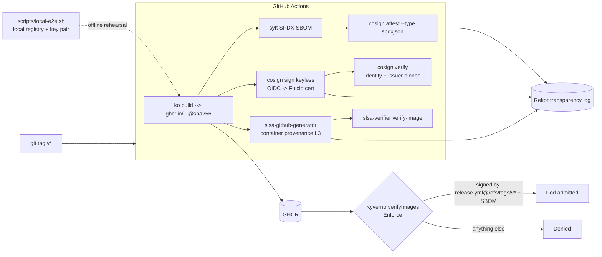

# Signed-by-default — cosign keyless + SBOM attestation + SLSA L3 provenance + Kyverno admission

> **Lab project.** The offline end-to-end run below used a **throwaway local registry and a lab key pair**. The keyless/Rekor/SLSA path only runs on GitHub Actions and **has not run yet** until the first push. 

## Problem
After SolarWinds and xz-utils, "we scanned the image" isn't enough. A cluster should only run images that it can prove (1) came from **my** CI workflow, (2) weren't modified after build, and (3) come with an SBOM. This repo sets that up end to end for a tiny Go service: build with ko (no Dockerfile, distroless base) → SBOM with syft → **keyless** cosign signature + SBOM attestation (Fulcio certificate bound to the workflow identity, logged in Rekor) → SLSA Build L3 provenance → Kyverno `verifyImages` blocks anything else at admission.

## Architecture


## Run
```bash
cd app && go test ./... && cd ..
pip install pytest pyyaml && pytest -q              # static guards on the workflow + policy
# needs: go, ko, syft, cosign v3, crane, registry (go-containerregistry) on PATH
./scripts/local-e2e.sh                              # offline build/sign/attest/verify/tamper
./scripts/kyverno-check.sh                          # kyverno CLI admission test, no cluster
# real keyless run: push a tag v0.1.0 to GitHub (not done; repo is local only)
```

## Results (actual runs, 2026-10-11, local run, no Docker)
`scripts/local-e2e.sh` → `results/e2e.log`: **ALL E2E CHECKS PASSED**
| Step | Result |
|---|---|
| ko build → local registry | `localhost:5055/app@sha256:f04324ef…` |
| syft SPDX SBOM | 6 packages (`results/sbom.spdx.json`) |
| cosign sign + attest (key pair, tlog disabled) | OK |
| cosign verify / verify-attestation | OK |
| verify with the **wrong public key** | rejected ✅ |
| image **mutated** (new label → new digest `b770ca40…`) | rejected ✅ |

`go test`: 1/1 passed. `pytest`: 7/7 passed. The guards cover default `contents: read`, `id-token: write` only on build, no static `--key` in release, signing by digest, pinned identity/issuer, SLSA generator by tag, and Kyverno Enforce + SBOM attestation.
`kyverno apply` (CLI 1.19.1): the policy validates (the first version was **rejected** for a missing Rekor URL on the attestation attestor, now fixed). An out-of-scope image gets no rule, and an in-scope unsigned image **fails** (fail-closed).

## Limitations
- **Not run:** keyless signing, Rekor upload, SLSA provenance generation and `slsa-verifier`. All of them need GitHub OIDC and a push. The registry is local-only by design.
- The Kyverno test is CLI-only (no kind cluster, since there's Docker not run yet). The "signed image admitted" positive path wasn't exercised.
- `ghcr.io/ansarshaikh/...` and the identity regex use a placeholder GitHub username. Change it before the first release.
- The offline e2e skips Rekor (`--tlog-upload=false`, `--insecure-ignore-tlog`). That's fine for rehearsal and never acceptable in prod.
- No vulnerability gate on the SBOM yet (grype/trivy). That's the next step.

## Sources
- Sigstore cosign keyless — https://docs.sigstore.dev/cosign/signing/overview/
- SLSA container generator — https://github.com/slsa-framework/slsa-github-generator/blob/main/internal/builders/container/README.md
- slsa-verifier — https://github.com/slsa-framework/slsa-verifier
- Kyverno verifyImages — https://kyverno.io/docs/writing-policies/verify-images/sigstore/
- syft — https://github.com/anchore/syft ; ko — https://ko.build
- Inspiration: https://github.com/janfuhrer/podsalsa

## Related work

This is my own implementation. Ideas came from [janfuhrer/podsalsa](https://github.com/janfuhrer/podsalsa).
